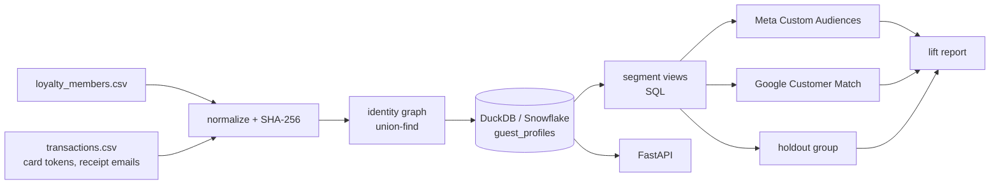

# guestgraph

**Identity resolution and audience activation for restaurant transaction data.**

Most restaurant guests never scan a loyalty ID. They tap a card, eat, and leave as an anonymous
transaction. `guestgraph` links those anonymous visits to real guests using loyalty profiles,
card tokens and receipt emails. It builds audiences ("regulars who've gone quiet", "frequent
guests who never joined loyalty"), sends them to ad platforms as hashed identifiers, and
measures whether the campaign brought people back.

Everything runs locally on synthetic data: no accounts, no keys, no cost.

```
$ pip install -e ".[dev]"
$ guestgraph demo

Transactions: 18,655  resolved to a guest: 94%
Guests: 1,716  loyalty members: 504  non-loyalty but reachable: 492
Shared cards blocked from linking: 2
Against ground truth: 1,474 real people -> 1,716 guest IDs; purity 99.9% (no strangers merged), 1.17 IDs per person
  segment lapsed_regulars          203 guests,   112 reachable
  segment high_value               172 guests,   150 reachable
  segment non_loyalty_regulars    1016 guests,   451 reachable
  segment new_guests                16 guests,     6 reachable
  meta    dry-run upload: 112 rows in 1 batch(es), 0 skipped
  google  dry-run upload: 112 rows in 1 batch(es), 0 skipped
lapsed_regulars: 39.2% of exposed guests returned vs 46.7% of the holdout (-16% relative lift, p=0.582,
not significant yet; n=97+15). Too small to call: spotting a 25% lift needs about 621 guests per group, ...
```

## How it works



1. **Normalize and hash** (`normalize.py`). Emails are trimmed and lowercased; Gmail dots
   and `+tags` collapse to one inbox. Phones in any format become E.164 digits. Raw
   identifiers are hashed with SHA-256 at ingestion and never stored.
2. **Resolve identities** (`resolve.py`). Every identifier is a node; the data supplies the
   edges (member ↔ profile email/phone, member ↔ card used in the same transaction,
   receipt email ↔ card). Connected components, found with union-find, are guests.
   *Guard against over-merging:* a card that shows up with more than two different loyalty
   members (an office or family card) is not used as a link, so strangers don't get merged.
3. **Profile and segment in SQL** (`sql/profiles.sql`, `sql/segments.sql`). Visits, spend,
   recency and home store per guest. Segments are views, so the rules live in one
   reviewable place.
4. **Activate** (`activation/`). One connector per platform, sharing batching, retry with
   exponential backoff on 429/5xx (it honours `Retry-After`), and dry-run mode that writes
   the exact payloads to disk. A detail that matters: **Google hashes phones as
   `+15512353720`, Meta as `15512353720`**, so the same guest needs two different phone
   hashes. Get that wrong and the match rate quietly drops.
5. **Measure** (`measure.py`). A deterministic, hash-based holdout (15%) is never sent to
   the platforms. Lift is exposed-vs-holdout return rate with a two-proportion z-test, plus a
   sample-size check so a small test isn't over-read.
6. **Evaluate** (`evaluate.py`). The generator records who really made each purchase, so
   resolution is scored on **purity** (no strangers merged) and **fragmentation** (one
   person split across several IDs). These two pull in opposite directions; the shared-card
   guard trades a little fragmentation for purity, because sending one person's offers to
   someone else is the worse mistake.

## Run it

```bash
pip install -e ".[dev]"
guestgraph demo                     # synthetic data -> data/, results -> out/
pytest                              # 26 tests
uvicorn guestgraph.api:app --reload # http://localhost:8000/docs
```

API endpoints: `GET /summary`, `GET /segments`, `GET /guests/{guest_id}`,
`POST /segments/{segment}/activate?platform=meta|google` (dry run only in the demo).

Use your own data: `guestgraph run path/to/csvs` with `loyalty_members.csv`
(`member_id,email,phone,joined_on,home_store`) and `transactions.csv`
(`txn_id,store_id,txn_date,amount,card_token,member_id,receipt_email`).

Docker: `docker build -t guestgraph . && docker run -p 8000:8000 guestgraph`.

## Cloud version (AWS)

`aws/` holds a Lambda function and a SAM template: drop `transactions.csv` and
`loyalty_members.csv` into `s3://<bucket>/incoming/`, and the function rebuilds the audiences
and writes them to `audiences/<date>/`. The bucket is encrypted and blocks public access.

```bash
make lambda                      # packages the library + handler into aws/build/
cd aws && sam build && sam deploy --guided
```

## Porting to Snowflake

DuckDB stands in for the warehouse. The SQL sticks to features both share; to move it:
`DATE_DIFF('day', a, b)` → `DATEDIFF('day', a, b)`, `QUANTILE_CONT` → `PERCENTILE_CONT ... WITHIN GROUP`,
and `read_csv_auto` → a stage plus `COPY INTO`. Identity resolution would run as a Snowpark
Python job or stay in this service, writing `txn_guest` and `guest_identity` back.

## What I'd build next

- Probabilistic matching (name + store + time window) for guests with no shared identifier.
- Incremental resolution: update the graph per batch instead of rebuilding it.
- A Java/Spring Boot version of the activation service, and The Trade Desk / LiveRamp connectors.
- Consent and deletion handling (honour opt-outs before any upload; propagate deletes).

## Project layout

```
src/guestgraph/
  normalize.py      identifier normalization + hashing
  resolve.py        identity graph (union-find) with shared-card guard
  warehouse.py      DuckDB load, profiles, segments
  sql/              profiles.sql, segments.sql
  activation/       base (batching, retries, dry run), meta.py, google_ads.py
  measure.py        holdout assignment, lift, sample size
  evaluate.py       purity / fragmentation against ground truth
  generate.py       synthetic data with realistic mess
  api.py, cli.py
aws/                Lambda handler + SAM template
tests/              26 tests, run in CI on every push
```

All data here is synthetic. Platform payload formats follow the public Meta Marketing API and
Google Ads API docs; nothing is sent to a real platform unless you supply credentials and
turn dry run off.
